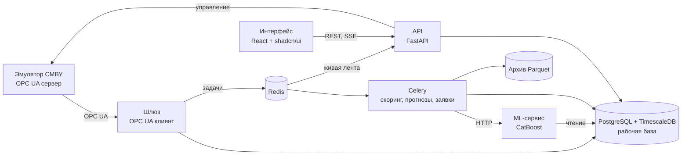

# lct_burrgers

ЛЦТ-2026, задача 8 — сервис прогнозирования отказов оборудования инженерных коллекторов АО «Москоллектор».

Диспетчер ОДС получает от системы мониторинга поток тревог. Заметная часть из них — плановые проверки и
неисправные датчики. Сервис:

- **в момент дымовой тревоги** говорит, что это: плановая проверка, вероятная неисправность датчика или повод
  реагировать;
- **раз в сутки** показывает, какое оборудование откажет в ближайшие 1–30 суток;
- **сам заводит заявки** на превентивное ТО по прогнозам и простым правилам.

Данные приходят так же, как придут от настоящей СМВУ, — по OPC UA: эмулятор транслирует реальные серии событий
2026 года в реальном времени.

## Что умеет

| Экран | Что показывает |
|---|---|
| Лента тревог | Живая лента дымовых тревог с вердиктом, оценкой модели и действием |
| Дашборд | Ключевые показатели, каналы с наибольшим риском отказа на 1–30 суток, риск по объектам и типам датчиков |
| Карта объектов | Интерактивный граф: район → 16 объектов → 78 подобъектов → каналы; тревоги пульсируют на узлах |
| Карточка канала | История состояний и неисправностей, прогнозы с исходами, факторы прогноза |
| Журнал прогнозов | Каждый прогноз со сверкой по факту, живые Precision и Recall |
| Заявки | Автоматические по четырём правилам и ручные, статусы, выгрузка CSV |
| Модели | Версии, пороги, офлайн-проверка: PR-кривые, упреждение, каналы с историей и без, кварталы |
| Эмулятор СМВУ | Сценарии из данных 2026 года, скорость до ×60, каждый запуск — отдельный прогон |

REST API с документацией OpenAPI — `/api/v1/docs`.

## Модели и метрики

Проверка — I полугодие 2026, которое модели при обучении не видели. Обучение — 2022–2024, порог подобран
на II полугодии 2025.

| Модель | Что предсказывает | Упреждение | Precision | Recall |
|---|---|---|---|---|
| Событийная | После дымовой тревоги: уйдёт ли датчик в «Неисправен» в ближайшие 24 ч | Минуты — это триаж | 85.0% | 81.5% |
| Ежедневная | Для 8 типов каналов: начнётся ли неисправность через 1–30 суток | Медиана 8.4 сут | 77.7% | 52.2% |

Требование ТЗ — Precision > 0.7, Recall > 0.5. Ограничения, которые мы не прячем:

- событийная модель — это триаж тревоги, а не предупреждение за сутки;
- 80% её решений на 2026 — тревоги внутри плановых проверок: там модель подсказывает, какой датчик проверку
  не пройдёт (P 88.6%, R 73.4%). Вне проверок — 1 663 решения, P 81.3%, R 93.3%;
- интервалы кластерного бутстрапа по объекто-суткам (90%) на 2026: P 78–90%, R 67–91%. I полугодие 2025 порогов
  не проходит: провал дали три плановые проверки в июне — отказы идут пачками по объектам;
- ежедневная модель предсказывает насосы, вентиляторы и фазу; для дымовых, газовых и температурных датчиков
  ежедневного прогноза пока нет; у каналов без неисправностей в 2022–2024 Recall 17%;
- каналы без истории событийная модель не распознаёт — их закрывает правило заявок по повторным одиночным тревогам.

Основные в продукте — базовые модели команды (v0). Событийная модель v3 ML-разработчика оценивает те же тревоги рядом,
теневой: на одних решениях она чуть точнее, v0 находит больше неисправностей и не слепнет после пропуска данных журнала —
[сравнение](ml/reports/compare-v0-v3/REPORT.md). Отдельные ежедневные модели по типам каналов — исследование, в сервис
не входят. Простое объяснение всего ML-решения — [ml/ML_SOLUTION_GUIDE.md](ml/ML_SOLUTION_GUIDE.md), цифры v0 —
[ml/reports/baseline-v0/REPORT.md](ml/reports/baseline-v0/REPORT.md).

## Как запустить

Нужны Docker Desktop (VM не меньше 8 ГБ), `uv`, `python3`, `curl`, около 30 ГБ диска. Данные хакатона положить
в `data/raw/`: два справочника и журналы `ext-journal-2019.csv` … `ext-journal-2026.csv`. В git их нет.

```bash
make bootstrap             # ~10 мин плюс сборка образов: стенд, архив, рабочая база, сценарии эмулятора
open http://localhost:18080
```

Дальше — экран «Эмулятор»: запустить сценарий «Одиночная тревога шумящего датчика» и открыть «Ленту тревог».
Ход показа на 5 минут — [docs/product/demo.md](docs/product/demo.md). Подробно о запуске — [DEPLOY.md](DEPLOY.md).

## Архитектура



Сервис устроен как промышленная система диспетчеризации:

- приём по OPC UA со стандартными кодами качества сигнала;
- два уровня хранения — рабочая база со значимыми изменениями и итогами (~50 млн строк) и сжатый архив всего
  журнала без потерь (313 млн событий, 1.7 ГБ);
- зона нечувствительности для газовых показаний;
- прогоны вместо перезаписи истории.

Модели считают признаки тем же кодом, что при обучении.

Подробно — [ARCHITECTURE.md](ARCHITECTURE.md).

## Стек

FastAPI, Celery, PostgreSQL + TimescaleDB, архив Parquet + DuckDB, Redis, Vite + React + shadcn/ui,
react-force-graph, CatBoost, OPC UA (asyncua), Docker Compose.

## Для разработчиков

| Документ | Зачем |
|---|---|
| [AGENTS.md](AGENTS.md) | Правила работы — обязательны для людей и агентов в каждой итерации |
| [ARCHITECTURE.md](ARCHITECTURE.md) | Обзор архитектуры и указатель на части: фронтенд, backend, ML-сервис, эмулятор СМВУ, данные |
| [DEPLOY.md](DEPLOY.md) | Запуск, окружения, выкатка, доступ к проду |
| [FEATURES.md](FEATURES.md) | Реестр крупных фич — пополняется только после подтверждения владельца |
| [docs/PLAN.md](docs/PLAN.md) | План с актуальным статусом |
| [docs/QUESTIONS.md](docs/QUESTIONS.md) | Открытые вопросы и допущения |
| [docs/IDEAS.md](docs/IDEAS.md) | Идеи вне текущего плана |
| [docs/product/directions.md](docs/product/directions.md) | Направления ТЗ: что берём, что нет, чего не хватает |
| [docs/product/v1-scope.md](docs/product/v1-scope.md) | Состав первой версии |
| [docs/api.md](docs/api.md) | Контракты API |
| [docs/testing/scenarios.md](docs/testing/scenarios.md) | Тестирование на сценариях: что в данных, что должна выдать система, что показала; как исследовать |
| [docs/data-format.md](docs/data-format.md) | Формат исходных данных, словари значений, дефекты |

```
backend/     FastAPI + Celery: api, worker, beat, шлюз OPC UA
ml-service/  скоринг моделей ML
emulator/    эмулятор СМВУ: OPC UA сервер, сценарии
web/         интерфейс диспетчера: Vite + React + shadcn/ui
infra/       docker-compose стенда, шаблон .env
ml/          модели, код признаков и обучения, отчёты
data/        исходные данные (в git только README)
docs/        ТЗ, исследования, продукт, архитектура по частям, план, вопросы, идеи, API
scripts/     служебные скрипты: bootstrap.sh, open_pr.py, merge_pr.py
tech/        временное и разовое — для проектирования не нужно
```
